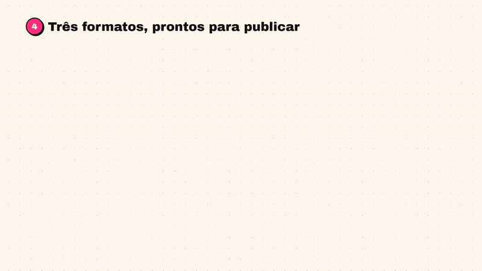

### Oi, sou José Carlos 👋

Desenvolvedor Python no Rio de Janeiro. Há mais de 3 anos construo automações que tiram trabalho manual
do caminho e, hoje, uso IA generativa para levar ideias a produtos funcionando em poucos dias.

- 💼 Desenvolvedor de Software na Orizon: automação e integrações em Python
- 🎓 Análise e Desenvolvimento de Sistemas na Estácio (conclusão em 2027)
- 🤖 Foco atual: IA aplicada, com LLMs, speech-to-text e automação

### 🚀 Projetos em destaque

| Projeto | O que faz | Stack |
|---|---|---|
| [English Zé](https://github.com/Teodorox/english-ze) | Plataforma de estudo de inglês: a IA corrige o que você escreve e transforma cada erro em flashcard; checa a pronúncia com Whisper | FastAPI · PostgreSQL · Claude API · Whisper |
| Painel Vizinha Online | Automação de conteúdo para Instagram: traz os assuntos em alta, gera o post com IA e legenda vídeos em português. Montar um post caiu de 10–15 min para 1–2 min (demonstração abaixo) | FastAPI · Claude API · Deepgram · ffmpeg |

### 🎬 Painel Vizinha Online em ação

Da notícia ao post pronto: o painel acha os assuntos em alta, a Claude API escreve a pauta e as artes saem
prontas em três formatos. Nada é publicado sem aprovação. O código é privado, então o vídeo mostra o fluxo completo:

https://github.com/user-attachments/assets/cf5f4278-368c-4c8b-a1d9-9b3bfa7a0e15

Demonstração com dados ilustrativos; notícias de exemplo do g1. Trilha: "Upbeat Groove", de sub_clair (Pixabay).

### 📈 Resultados no trabalho
- Processo operacional crítico reduzido de **~9 horas para 40 minutos** com automação em Python
- **Mais de 15 soluções corporativas** entregues, do levantamento de requisitos à produção

### 🛠️ Ferramentas

Claude API · Whisper · Deepgram · Selenium · Playwright · Automation Anywhere

### 📫 Contato

